# Vibe Coding for Non-Technical Professionals

Illustrated participant guide | All Things AI | October 2026

[PDF edition](participant-guide.pdf) · [Start here](../START-HERE.md)

## 01. Vibe Coding for Non-Technical Professionals

Your first website. Your first game. Your next idea.

A website. A game. A repeatable way to turn an idea into working software.

No programming experience required. Bring your favorite chatbot and learn to describe, build, check, save, and publish.

**Keep in mind**

Six teaching hours, plus lunch and breaks.

Mark Hinkle | All Things AI

Participant edition | October 2026

[Detailed lesson: START-HERE.md](../START-HERE.md)

## 02. Two projects. One useful process.

Use this guide as a map. The repository holds the detailed instructions and recovery steps.

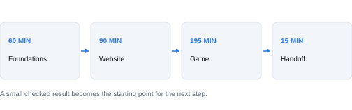

1. FOUNDATIONS - 60 minutes. Understand the software lifecycle, then prepare GitHub, Vercel, and your chatbot.
2. WEBSITE - 90 minutes. Define one page, build it, test its main action, and publish it.
3. GAME - 195 minutes. Choose a pattern, write rules, build a playable loop, improve it, playtest, and publish.
4. HANDOFF - 15 minutes. Demonstrate both projects and save your next action.

**Keep in mind**

Go at your own pace outside class. A checkpoint is a visible result, not a number of prompts sent.

Quick page finder: AI handoff 3; lifecycle 4; tools 5; setup 6; website 7-9; game 10-12; troubleshooting 13; agents 14-15; resume 16; checklist 17; resources 18.

[Detailed lesson: instructor-guide.md](../instructor-guide.md)

## 03. Start with the right context.

A chatbot can help only with the material and tools it can actually access.

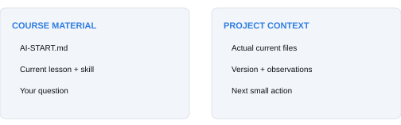

1. Open START-HERE.md. If your assistant can read the authorized repository, direct it to AI-START.md.
2. If it cannot read the private link, download AI-COURSE-PACK.md and attach it. If file upload fails, paste AI-START.md and the current lesson.
3. Ask it to identify the files it received, both projects, and your next checkpoint. A vague summary is not proof of access.

**Try this prompt**

> Be my patient course guide. Read AI-START.md and tell me which files you actually received. I am starting fresh / continuing / stuck. Give me one next action and tell me what success will look like.

**Keep in mind**

The course repo is private. Your instructor must grant access or supply a copy. Never share a password or access token to make a link work. ZIP uploads are not supported by every chatbot.

[Detailed lesson: START-HERE.md](../START-HERE.md)

## 04. How software gets made.

The software development lifecycle is a set of questions you revisit as you learn.


Discover the user and purpose. Define the smallest useful result. Design the experience and plan small steps. Build one increment. Test the actual behavior. Release the checked version. Maintain it as needs change.

### Make each stage concrete

Website: a visitor should find event details and open a directions link. Game: a player should answer five questions, see an accurate score, and play again. Those promises become tests.

**Try this prompt**

> Explain our current stage using my project. What decision do I need to make, what file should we produce, and what can a person do to check the result?

**Keep in mind**

You can return to an earlier stage. A confusing result may need a better rule or clearer wording, not more code.

[Detailed lesson: instructor-guide.md](../instructor-guide.md)

## 05. Know what each tool does.

The chatbot helps create files. Your browser shows what those files actually do.

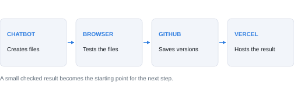

HTML gives a page structure. CSS controls its appearance. JavaScript supplies behavior, such as answering a quiz or restarting a game. Both core projects can run as plain static files.

1. CHATBOT: creates or changes project files. Its response is a proposal until checked.
2. GITHUB: stores your files and their saved history. A commit is a named checkpoint; a branch is a separate line of changes.
3. VERCEL: hosts a deployed version at a URL. Your browser opens that URL; the local copy may differ.

**Keep in mind**

A repository is not the same thing as a live website. A private repository also does not prove that its deployed website is private.

A pull request proposes a branch change for review. A preview deployment helps you inspect a change before a later production release.

[Detailed lesson: docs/glossary.md](../docs/glossary.md)

## 06. Choose the route that works.

Start with complete runnable files. Add connected tools only when they help.

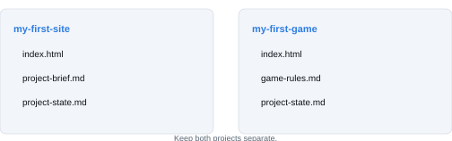

1. Create or sign in to GitHub and Vercel using setup-guide.md. Keep your account recovery details private.
2. Choose your chatbot. Ask it for a downloadable index.html, or complete plain-text contents you can save.
3. Create a website folder and learner-owned repository. Keep the game in a second folder and repository later.
4. Open the exported file in your browser. Confirm the filename ends in .html, not .html.txt, and that it is plain text.

**Try this prompt**

> Confirm whether you can return complete files, edit my project, run checks, and access GitHub or Vercel. Mark each verified, unavailable, or not tried. Use the portable route for anything you cannot do here.

**Keep in mind**

No API key, database, or paid integration is needed for the core projects. Confirm hosting suitability before class: Vercel Hobby is for noncommercial personal use. Native skills and multiple agents are optional.

[Detailed lesson: setup-guide.md](../setup-guide.md)

## 07. Give the page one clear job.

Start with a small, specific promise to one kind of visitor.

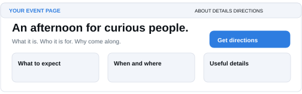

Choose a starter or make your own: vanilla, two All Things AI fan sites, dream restaurant, dream product, dream business, or pet. Download the course and open website-starters/index.html. Copy the chosen folder into your own project.

1. Write the audience and desired outcome in one sentence.
2. Scope WHAT: one page, three sections, one useful action. Put extra features in a later list.
3. Plan HOW: three small changes, each with a visible check. Check purpose, content, action, navigation, and phone layout.

**Try this prompt**

> Use vc-project-brief, vc-project-scope, and vc-project-plan. Help me define who and why, what belongs now, and how to build in three increments. Include the exact destination or behavior of the main action.

**Keep in mind**

Save your brief, scope, and plan. Use content and images you have permission to use. Fictional examples should be visibly fictional; do not invent testimonials or working services.

[Detailed lesson: docs/scope-and-plan.md](../docs/scope-and-plan.md)

## 08. Build small. Look. Then improve.

A specific change is easier to check than an instruction to make everything better.

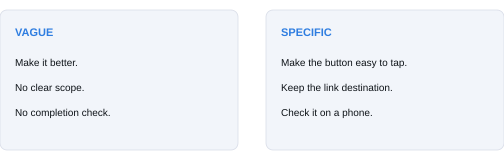

1. Ask for the smallest complete page. A single index.html can contain its styles and behavior.
2. Save and open the actual exported file. If separate images or scripts are supplied, keep their paths intact.
3. Try the main action. Save a working copy before asking for one improvement.
4. Repeat the same check after the change and inspect anything that should have stayed the same.

**Try this prompt**

> Build the first increment from my brief. Return the complete runnable file. Then change only the heading and button placement for phone readers. Preserve my content, destinations, and working links.

**Keep in mind**

An image of a page is a design reference. It is not a runnable website. If the assistant only gives a screenshot, ask for the complete project files.

[Detailed lesson: docs/website-walkthrough.md](../docs/website-walkthrough.md)

## 09. Check before you share.

Publishing and verification are two separate steps.


1. Have another person explain the page and follow its main action. Try all links, keyboard navigation, and a narrow screen. Record real observations.
2. Upload the checked files, not the ZIP, to your own website repository. Confirm index.html is at the selected project root.
3. Import that repository into the correct Vercel account/project. For plain static files, follow the Other / empty build command setup in setup-guide.md.
4. Confirm the intended publication, deploy, and repeat the main checks at the actual URL. Record that URL and the released version.

**Keep in mind**

The first Vercel deployment is production. Later updates to the configured production branch can publish automatically. Use branches and previews for later changes.

If deployment fails, keep your working files and record the exact error. A green build indicator is not evidence that the main button works.

[Detailed lesson: setup-guide.md](../setup-guide.md)

## 10. Battle an alien. Claim a square.

Use a familiar pattern, then make the theme your own.

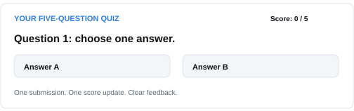

Pick one: Alien Tic-Tac-Toe (featured), a five-question quiz (easiest), or a one-button space dodger (action). Mark proposed the alien game; the alternatives draw on Arcade patterns.

### Alien Tic-Tac-Toe: a solo variant

Choose an empty square, then battle an alien. Win to claim X; lose and the alien claims O. Three Xs wins; three Os loses; a full board with no line draws. There is no extra opponent move. Build the board and short turn-based battle separately, then connect them.

**Try this prompt**

> Use vc-game-brief and vc-game-rules. Write the player goal, main action, keyboard and touch controls, score rule, round ending, and restart behavior. Give me five observable checks.

**Keep in mind**

Keep the first version small. Accounts, multiplayer, global rankings, daily locks, and remote score services can wait. Educational facts need reliable sources; a game can simply be fun.

[Detailed lesson: docs/game-options.md](../docs/game-options.md)

## 11. Make the whole loop work.

State is what the game remembers: where you are, the score, and whether the round is over.

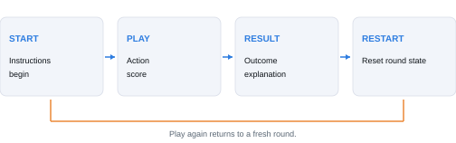

1. START: show short instructions and one clear way to begin.
2. PLAY: accept the intended input and update progress or score once.
3. RESULT: end the round, explain the outcome, and stop inappropriate input.
4. RESTART: reset the agreed state and begin a fresh round without duplicated timers or actions.

**Try this prompt**

> Build the complete start, play, result, and restart loop with plain visuals first. Keep rules separate from drawing where practical. Explain how I can test one round and three restarts.

**Keep in mind**

Try rapid double-clicks or taps where relevant. A quiz should not award points twice; an animated game should not run faster after every restart. Make controls match the instructions.

[Detailed lesson: game-skills-guide.md](../game-skills-guide.md)

## 12. Watch a new player.

Two minutes without coaching can reveal what your own testing misses.

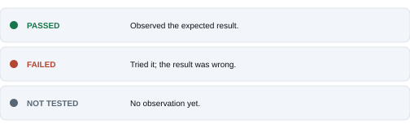

1. Give the current version to a partner. Let them start, play, finish, and restart without hints.
2. Record hesitation, control errors, unfair outcomes, and scoring surprises. Ask whether they would replay and why.
3. Fix the biggest issue. Tune only one setting, such as speed or time, then repeat the same test.
4. Publish to a separate game repository and Vercel project. Repeat a round and restart at the deployed URL.

**Try this prompt**

> Review this exact version against game-rules.md. Separate observed failures from suspicions. Help me repair the biggest problem and retest it. Do not mark a phone test Passed if we only resized a desktop browser.

**Keep in mind**

Use Passed, Failed, and Not tested. If you include local best scores, test refresh and unavailable storage. Sound is optional; gameplay should remain understandable without it.

[Detailed lesson: docs/game-options.md](../docs/game-options.md)

## 13. Diagnose one thing at a time.

Keep the last working version. Avoid turning a small failure into a full rewrite.

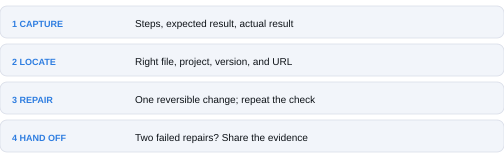

1. NAME THE SYMPTOM: exact click or input, expected result, actual result, error text, file or URL, and browser/device.
2. CHECK THE CONTEXT: correct project, latest file, filename, folder path, branch, and deployment.
3. TRY ONE REPAIR: make the smallest reversible change and repeat the same check.
4. ESCALATE WITH EVIDENCE: after two unsuccessful focused repairs, summarize what happened and ask for help.

**Try this prompt**

> I expected [result] after [steps]. I observed [result/error] in [file/URL]. The last change was [change]. Help me test one likely cause. Preserve the working parts and say how we will know the fix worked.

**Keep in mind**

Use docs/troubleshooting.md for symptom-by-symptom recovery, including blank pages, .html.txt, missing files, stale deployments, broken controls, agent conflicts, and lost chat context.

[Detailed lesson: docs/troubleshooting.md](../docs/troubleshooting.md)

## 14. Give every helper a clear job.

Start with one builder and one reviewer. More agents are useful only when the work can be separated.

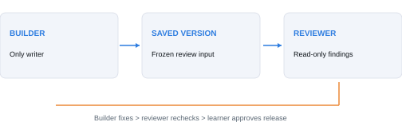

1. TWO CHATS: let one assistant build. Give another chat the same brief and a frozen copy to review read-only. Send useful findings back to the builder.
2. NATIVE SUBAGENTS: where supported, ask for one bounded helper, such as drafting acceptance checks. Keep one writer on the application files.
3. ISOLATED WORKTREES: advanced coding work can use separate folders and branches. A coordinator integrates the results and repeats the tests.

**Try this prompt**

> Use one helper to review this exact saved version read-only. Give it the brief and test criteria. Do not let it edit or publish. Return concrete issues with reproduction steps, then propose a small fix.

**Keep in mind**

Different role names are not independent reviewers. Separate agents can still share a model or provider. A second provider is optional and requires a deliberate data-sharing choice. Extra agents consume extra usage; keep this outside the core timebox if it slows you down.

[Detailed lesson: docs/multiple-agents.md](../docs/multiple-agents.md)

## 15. Give your AI a working agreement.

AGENTS.md is a short instruction file for your own project, not a magic installation command.

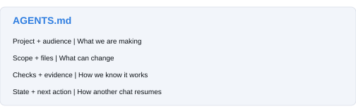

1. Copy templates/AGENTS.md into your learner project as AGENTS.md. Fill in the project identity, intended user, and scope.
2. Add your expected behavior, how to open the project, how to test it, and where to record progress.
3. Ask your assistant to read and summarize the rules before making changes. In ordinary chat, paste or attach the file.
4. Use templates/CLAUDE.md only as described in the optional agent guide. Product discovery differs by client and version.

**Try this prompt**

> Read AGENTS.md and my current files. Tell me which project you are working in, the next allowed change, how you will test it, and what would require my decision. Do not claim you read instructions you could not access.

**Keep in mind**

Use the sample inside templates/. The course root AGENTS.md routes assistants through the course; it is not the learner-project template. Instruction files guide behavior but do not replace platform permissions or tests.

[Detailed lesson: templates/AGENTS.md](../templates/AGENTS.md)

## 16. Save context outside the chat.

Your files and a short state record make it easier to switch assistants or continue tomorrow.

1. Save the latest working project files and name the checkpoint or commit.
2. Update project-state.md: goal, scope, folder/repository, current stage, tested behavior, unresolved issue, and one next action.
3. Give the next assistant both the state record and the actual files. Include the relevant course lesson or skill.
4. Ask it to identify the version and missing evidence before continuing. Keep publication permission tied to the intended destination.

**Try this prompt**

> Read my project-state.md and attached files. Summarize what works, what failed or was not tested, and the next action. Ask for missing files. Continue from the saved state without rebuilding everything.

**Keep in mind**

Keep the website and game state records separate. Do not rely on an assistant remembering another chat or accessing a private conversation link.

[Detailed lesson: templates/project-state.md](../templates/project-state.md)

## 17. What does done look like?

Show the result, identify the version, and state the limits.

### Website

A visitor understands the purpose, reads accurate content, follows the primary action, uses navigation, and can read the page on a phone-sized screen. The published URL has been checked, or the deployment blocker is recorded.

### Game

A new player understands the instructions, uses the supported controls, receives correct scoring and a clear result, and can restart repeatedly. The deployed version has been played, or working files and the blocker are retained.

### Your handoff

Name the owner, files, repository, version, URL, test report, known limits, and next improvement. Demonstrate the website action and a full game round. Explain one assumption you corrected using evidence.

**Keep in mind**

Published and checked; published but verification incomplete; or working files with deployment blocked. Use the statement that matches your evidence.

[Detailed lesson: handouts/student-workbook.md](../handouts/student-workbook.md)

## 18. The right help, one click away.

All core instructions are readable as text, so your chatbot can use them alongside you.

1. START-HERE.md - access the course, choose a route, and give your AI the starting prompt.
2. AI-COURSE-PACK.md - a single text file containing the current learning instructions, templates, and skills.
3. docs/website-walkthrough.md and docs/game-options.md - website steps and three game choices.
4. docs/troubleshooting.md - symptom-led recovery. templates/help-request.md - an evidence-based request for help.
5. docs/multiple-agents.md and templates/AGENTS.md - optional collaboration and project instructions.
6. handouts/student-workbook.md and templates/project-state.md - records you can reuse in both projects.

Proud of your game? Use docs/arcade-submission.md to prepare a review packet for Mark and All Things AI. Selected games may join the Arcade after later integration.

### Share your experience. Get a skill endorsement.

Add vibe coding to your LinkedIn profile, post an honest account of the class, and send Mark your profile and post links. Connect with him if needed. Mark will endorse the skill you practiced. Participation is optional; see docs/linkedin-wrap-up.md for the post example and details.

### Sources and edition notes

The setup guide cites official GitHub, Vercel, OpenAI, and Claude documentation. Product guidance was checked October 5, 2026; screens and account availability may change. The source map records the original website course, existing presentation, and Arcade research.

Brand palette and logo come from the existing All Things AI class presentation. Diagrams in this guide are conceptual illustrations, not screenshots of provider interfaces. The detailed Markdown is the living reference.

**Keep in mind**

The guide is a learning aid. Website starters have local checks; game checkpoints and full classroom rehearsal remain preparation tasks. A documented workflow is not a claim that every provider or device has been exercised.

[Detailed lesson: repository-map.md](../repository-map.md)
